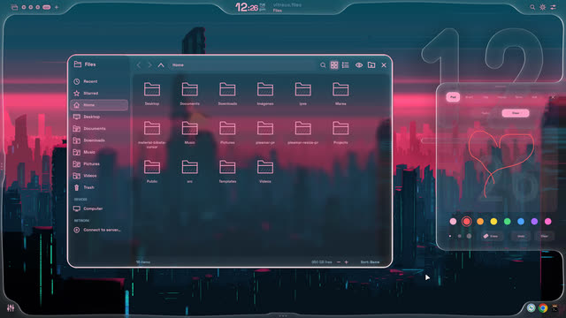
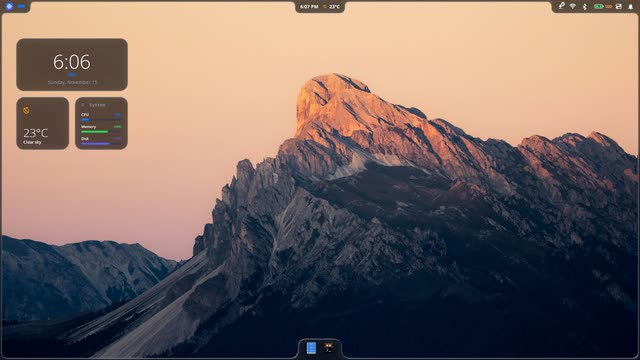

<div align = center>


<br>

[![Badge License]][License]
![Badge Language]
![Badge Commit]
[![Badge Issues]][Issues]
[![Badge Discord]][Discord]
[![Badge X]][X]
[![Badge Ko-fi]][Ko-fi]

<br>

A language and a Rust runtime for your desktop shell: bars, launchers,
notification centres, docks, lock screens and widgets, written as **scenes**
where every property is a spring and the animation never waits for the logic.

<br>

---

**[<kbd> <br> Install <br> </kbd>][Install]**
**[<kbd> <br> Guide <br> </kbd>][Guide]**
**[<kbd> <br> Reference <br> </kbd>][Reference]**
**[<kbd> <br> pleamar-wm <br> </kbd>][pleamar-wm]**
**[<kbd> <br> Marea <br> </kbd>][Marea]**
**[<kbd> <br> Discord <br> </kbd>][Discord]**

---

<br>


<sub>`examples/glass.plm`, running: a clear lens, a plate that frosts itself where what is behind is busy, smoke and milk.</sub>

<br>
<br>

</div>

# What it is

**pleamar is a shell toolkit, like Quickshell.** You write your bar, widgets and
launchers with it, and they run **on the compositor you already use** —
Hyprland, Sway, niri, KDE… No need to change anything else.

Two more pieces are built on it, both optional:

- **[pleamar-wm]** is a Wayland compositor where the window manager itself is a
  pleamar scene. Only if you want a whole desktop of it.
- **[Marea]** is my own shell, written in pleamar: a good example of how far a
  scene can go.

So if you are on Hyprland and just want a new bar, pleamar is all you need.

### Where it runs

| | |
| --- | --- |
| **Hyprland, Sway, niri, river, Wayfire, Labwc…** | ✅ Its home: bars, panels and shells anchor to the screen (layer-shell) |
| **KDE Plasma (Wayland)** | ✅ Bars and shells work; what is Hyprland's own —its workspaces— does not |
| **GNOME (Wayland)** | ⚠️ Only scenes in a normal window: GNOME has no layer-shell, so a bar cannot anchor. pleamar-wm can be picked as a session next to it |
| **pleamar-wm** | ✅ A whole desktop of its own. On `exp2`, with pleamar-wm built with `--features exp`, the programs' widgets on the desktop can be drawn inside the scene itself (`windows … desk N`) |
| **X11 sessions** | ❌ pleamar is for Wayland |

<div align = center>

# Gallery

<br>

<a href="https://youtu.be/KxVrg4OTpyk"></a>

<sub>Someone on Reddit drew this desktop and said they didn't know how to build it. One scene and twenty minutes later, it moves: **[watch it](https://youtu.be/KxVrg4OTpyk)**.</sub>

<br>
<br>


<sub>[Marea], a whole shell in one scene: here she changes her skin to liquid glass.</sub>

<br>
<br>

![Preview Desktop]

<sub>pleamar-wm with Marea: free windows, glass drop buttons, one scene each.</sub>

<br>
<br>

![Preview Effects]

<sub>`examples/effects.plm`: a WGSL aurora with glowing particles, a ripple that follows the pointer, a heat haze.</sub>

<br>
<br>

</div>

# Why pleamar

- **Motion first**: every property is a spring, and animation never waits for the
  logic; save the file and it reloads without losing what was in motion.
- **Drawing**: shapes that melt into each other, glass, blur, glow, particles and
  your own shaders.
- **A whole desktop**: bars, docks, launchers, lock screens, widgets, and with
  pleamar-wm the window manager itself.

More, with the numbers and a quick comparison with other toolkits: **[docs/why.md](docs/why.md)**.

# Install

One line installs pleamar, the [pleamar-wm] window manager and [Marea] in your
home (nothing outside it), and keeps them up to date:

```sh
curl -fsSL https://raw.githubusercontent.com/k4ditano/pleamar/main/install.sh | sh
```

**Only pleamar**, for the compositor you already use, without the window
manager or Marea — fewer packages to build it, and `pleamar-update` keeps it
that way:

```sh
curl -fsSL https://raw.githubusercontent.com/k4ditano/pleamar/main/install.sh | sh -s -- --alone
```

It tells you what your distribution is missing to build it (pacman, apt, dnf,
zypper) and offers to install it, builds in `~/.local/share/pleamar/src`, puts
`pleamar`, `pleamar-wm`, `pleamar-session`, `marea` and `pleamar-update` in
`~/.local/bin`, and makes your `~/.config/pleamar` the first time.

| | |
| --- | --- |
| `pleamar-update` | new changes, built and put in place (it says what is new) |
| `pleamar-update --alone` | pleamar alone from now on: pleamar-wm and Marea leave `~/.local/bin` |
| `pleamar-update --all` | pleamar-wm and Marea too, from now on |
| `pleamar-update --session` | also pleamar-wm in the login screen (asks for sudo) |
| `pleamar-update --agent` | AI agents may use your windows in pleamar-wm, with a cursor of their own |
| `pleamar-update --remote` | this desktop from a browser elsewhere: a password and codes made, and `pleamar-wm remote` started with the session |
| `pleamar-update --uninstall` | the programs go; your `~/.config/pleamar` stays |

**Everything of yours lives in `~/.config/pleamar/`** — the folder for your
dotfiles: your shells (`shells/`), what starts with the desktop (`autostart`;
on Hyprland or any other compositor, `exec-once = pleamar --autostart`), and for
pleamar-wm its `session.conf`, `keys.conf` and your own `wm/session.plm`.


On **Nix or NixOS**: [docs/install-nix.md](docs/install-nix.md).

# Your first scene

```plm
language 0.1
scene Clock {
    surface { size: 240, 96; anchor: top; margin: 12 }
    permissions { services: "clock" }

    //  The time comes from the system: not a single line of logic here.
    service clock as now { time: text = "--:--"; date: text }

    prop hot = 0 ~quick

    body {
        color: #151616
        rim: 6%
        shadow: 0, 6, 18, 35%
        box { from: 0, 0; size: 240, 96; corner: 20 }
    }
    text now.time { at: 120, 44; anchor: center; size: 34; color: #f5f7f5 }
    text now.date { at: 120, 72; anchor: center; size: 12; color: #9ed6bd; opacity: 45% + hot * 55% }

    zone box whole { from: 0, 0; size: 240, 96; corner: 20 }
    on enter whole { hot: 1 }
    on leave whole { hot: 0 }
}
```

`pleamar --scene clock.plm`, and it is on your screen. Save the file and it
reloads without losing whatever was in motion.


Next: the language in five minutes, in **[docs/quick-tour.md](docs/quick-tour.md)**.

# With your AI agent

The installer writes pleamar's skill for every agent it finds — **Claude Code,
Codex, OpenCode** — and it refreshes itself on every update. Ask one *«make me a
bar with the time, the volume and my workspaces»* and it knows the language,
where the file goes, how to start it with your desktop, and how to check it
(it compiles it, opens it without a screen and looks at the picture) before
saying it is done. `pleamar --install-skill` does it by hand;
`pleamar --docs` prints the documentation of the version you have. A film
(`--film`) never rewrites it, and `PLEAMAR_NO_SKILL_REFRESH=1` stops any run
from doing so.

**And it can use the desktop.** A second skill, `pleamar-desktop`, teaches it
pleamar-wm's agent hands (`pleamar-update --agent`, or `agent on` in
`session.conf`): ask *«go to reddit and find my last post»* and it looks at the
window, clicks and types with a mint cursor of its own, on a seat apart from
yours — your mouse and keyboard stay free, the monitor it works on glows while
it does, and it stops to ask before publishing, sending or buying anything. It
speaks [Cua Driver](https://github.com/trycua/cua)'s protocol too.

# Community shells

Desktops people have built with pleamar. Each one is its author's, under its own
license; the picture is the one they posted in the
[shells forum](https://discord.com/channels/1553805307736494100/1567251125990719519).

| | |
| --- | --- |
|  | **[Vitreus](https://github.com/natepayn3/Vitreus)** by natepayn3 · a liquid-glass shell for pleamar-wm, Hyprland and niri |
|  | **[Beskar](https://github.com/neerajlovecyber/beskar)** by neerajlovecyber · a liquid-glass shell for niri |

All of them, and how to add yours: **[docs/shells.md](docs/shells.md)**.

# Tools

`pleamar --lsp` gives errors and completion in your editor, `pleamar --docs` prints
the documentation of the version you have, and building from source or day-to-day
commands are in **[docs/tools.md](docs/tools.md)**. How it works inside:
**[docs/under-the-hood.md](docs/under-the-hood.md)**; what is missing and the known
limitations: [`docs/07-whats-missing.md`](docs/07-whats-missing.md),
[`docs/08-limitations.md`](docs/08-limitations.md).

# Documentation

| | |
| --- | --- |
| [`docs/guide.md`][Guide] | From zero to a bar, step by step |
| [`docs/recipes.md`](docs/recipes.md) | Patterns that already work, ready to copy |
| [`docs/11-language-reference.md`][Reference] | The reference: grammar, types, every element and every property |
| [`docs/10-luau-logic.md`](docs/10-luau-logic.md) | What the logic can do, and what it cannot |
| [`docs/07-whats-missing.md`](docs/07-whats-missing.md) | Parity with Quickshell, told by real usage |
| [`docs/08-limitations.md`](docs/08-limitations.md) | Everything that fails or is missing, with its plan, and what was fixed when |
| [`docs/02-how-it-works.md`](docs/02-how-it-works.md) | Inside: the threads, the renderer, the why |
| [`skill/`](skill/) | The skill the installer gives your AI agents |
| [`docs/why.md`](docs/why.md) | Why pleamar, with the numbers and the quick comparison |
| [`docs/quick-tour.md`](docs/quick-tour.md) | The language in five minutes, and the logic |
| [`docs/install-nix.md`](docs/install-nix.md) | Nix and NixOS |
| [`docs/tools.md`](docs/tools.md) | The editor, building from source, day to day |
| [`docs/under-the-hood.md`](docs/under-the-hood.md) | The three threads and the source tree |
| [`docs/whats-new.md`](docs/whats-new.md) | The highlights of each release line |
| [`docs/shells.md`](docs/shells.md) | Community shells |

The working notes (01, 03–06, 09) are the design logbook: how this got here.

# Special Thanks

<br>

**[wgpu]** - *For every pixel*

**[Luau]** - *For logic that can be sandboxed*

**[cosmic-text]** - *For real text*

**[resvg]** - *For reading svg*

**[Smithay]** - *For the compositor's protocol side*

**[Quickshell]** - *For showing what a desktop written in a language can be*

**[Hyprland]** - *For showing how good a desktop can feel*

# License

pleamar is under the [BSD 3-Clause License][License], like Hyprland: use it,
change it, ship it, sell it — keep the copyright notice. Every dependency is
permissive (MIT, Apache-2.0, BSD-3-Clause, Zlib); `THIRD-PARTY.md` lists them,
and their notices travel with any binary you hand out.

Contributions are welcome, made with AI or without it: see the [AI policy](AI_POLICY.md).

Made by **[@k4ditano][X]** — follow along on X for what comes next, and come
and say hi, ask or show what you made on **[Discord]**.
If it makes your desktop nicer, you can **[buy me a coffee on Ko-fi][Ko-fi]** ☕

<!----------------------------------------------------------------------------->

[Install]: #install
[Guide]: docs/guide.md
[Reference]: docs/11-language-reference.md
[pleamar-wm]: https://github.com/k4ditano/pleamar-wm
[Marea]: https://github.com/k4ditano/marea-plm
[License]: LICENSE
[X]: https://x.com/k4ditano
[Discord]: https://discord.gg/N7kbYC49b2
[Ko-fi]: https://ko-fi.com/k4ditano
[Issues]: https://github.com/k4ditano/pleamar/issues
[Releases]: https://github.com/k4ditano/pleamar/releases
[nixGL]: https://github.com/nix-community/nixGL

<!----------------------------------{ Thanks }--------------------------------->

[wgpu]: https://github.com/gfx-rs/wgpu
[Luau]: https://luau.org
[cosmic-text]: https://github.com/pop-os/cosmic-text
[resvg]: https://github.com/linebender/resvg
[Smithay]: https://github.com/Smithay/smithay
[Quickshell]: https://quickshell.outfoxxed.me
[Hyprland]: https://github.com/hyprwm/Hyprland

<!----------------------------------{ Images }--------------------------------->

[Preview Desktop]: assets/desktop.png
[Preview Effects]: assets/effects.png

<!----------------------------------{ Badges }--------------------------------->

[Badge License]: https://img.shields.io/badge/license-BSD--3--Clause-9ed6bd?style=flat-square
[Badge Language]: https://img.shields.io/badge/made%20with-Rust%20%2B%20Luau-2c7684?style=flat-square
[Badge Commit]: https://img.shields.io/github/last-commit/k4ditano/pleamar?style=flat-square&color=9ed6bd
[Badge Issues]: https://img.shields.io/github/issues/k4ditano/pleamar?style=flat-square&color=2c7684
[Badge Discord]: https://img.shields.io/badge/chat-Discord-5865f2?style=flat-square&logo=discord&logoColor=white
[Badge X]: https://img.shields.io/badge/follow-@k4ditano-000000?style=flat-square&logo=x
[Badge Ko-fi]: https://img.shields.io/badge/support-Ko--fi-ff5e5b?style=flat-square&logo=ko-fi&logoColor=white
