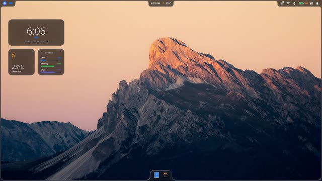
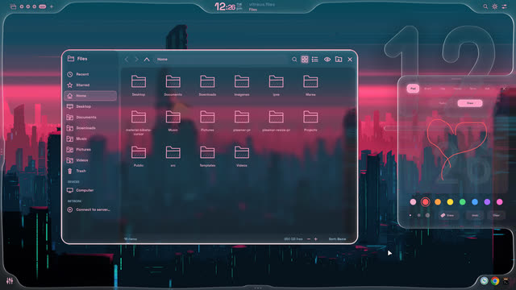

# Community shells

Desktops people have built with pleamar, newest first. Each one is its author's, under its own license: what is
here is a link to it and the screenshot they posted in the
[shells forum](https://discord.com/channels/1553805307736494100/1567251125990719519). Listed with the screenshot you
posted; tell us and we remove or change it.

| | Shell | Author | Runs on | pleamar | License |
| --- | --- | --- | --- | --- | --- |
|  | **[Beskar](https://github.com/neerajlovecyber/beskar)**: a thin glass frame round the screen, three islands on the top bar and a dock; Control Center, notifications, Spotlight, clipboard, wallpapers, settings, timer and lock screen grow out of them. Also the notification server, polkit agent and screenshot tool. Personal project, tested on one machine | neerajlovecyber | niri | 0.8.0-exp.24 | MIT |
|  | **[Vitreus](https://github.com/natepayn3/Vitreus)**: a liquid-glass bar (island, frame or notches) with panels that grow out of it; launcher, notifications, lock screen and SDDM theme, quick controls, media, settings, overview, file manager, screenshots and desktop widgets, themes and add-ons | natepayn3 | pleamar-wm, Hyprland, niri | 0.7.13 | MIT |

## Add yours

Post it in the [shells forum](https://discord.com/channels/1553805307736494100/1567251125990719519), one post per
shell: its name as the title, a public repository, at least one screenshot, where it runs, the pleamar version,
what it includes, its dependencies, how to install it, its license and you. Work in progress is welcome; say so.
Shells posted there may be listed here with the screenshot you attached; ask and we remove it.
